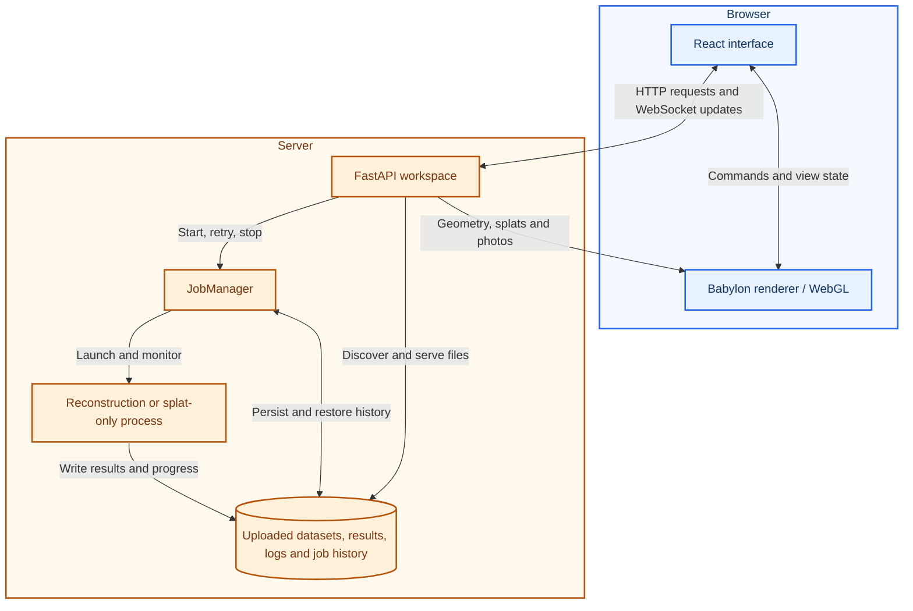
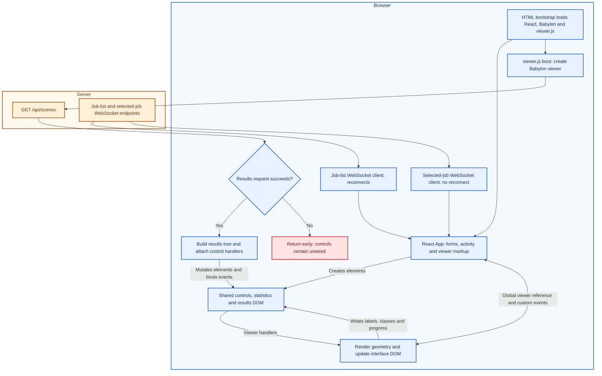
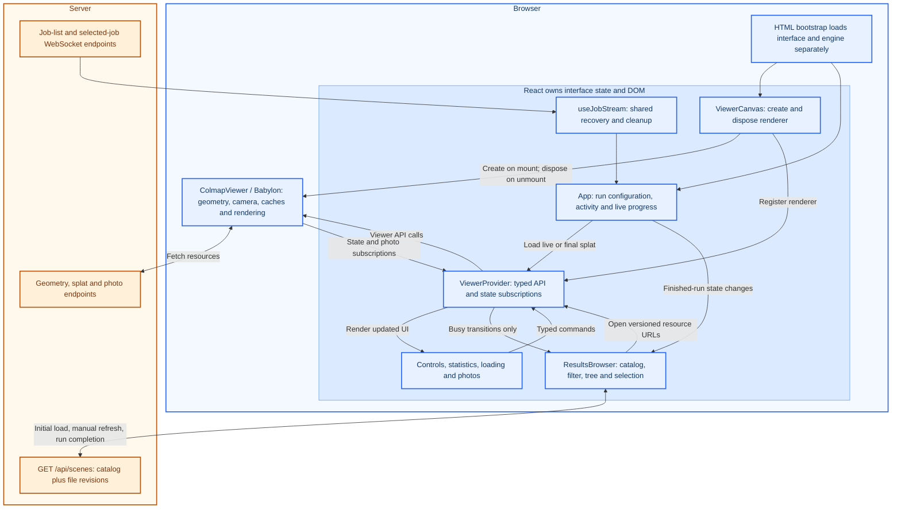
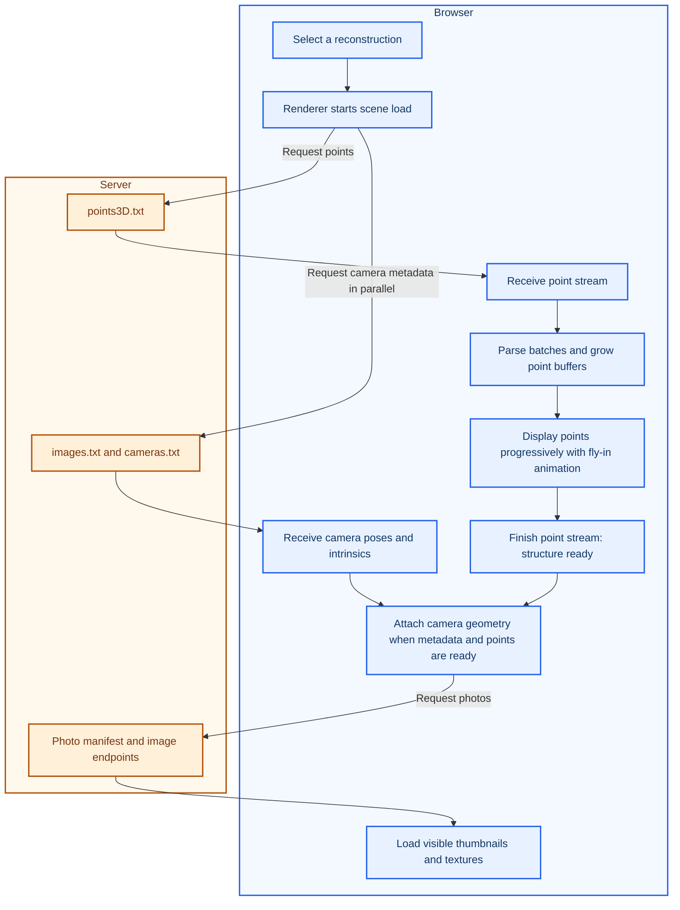

# GTSFM Studio: application flow before and after the UI refactor

**Before** refers to [PR #1166](https://github.com/borglab/gtsfm/pull/1166); **after** refers to [PR #1168](https://github.com/borglab/gtsfm/pull/1168).

## Application context

The browser renders the 3D scene on the client device. The server serves the application, manages jobs, and runs reconstruction. Optional remote/Modal execution is omitted for clarity.

**Color key:** blue = browser; amber = server; red = failure path. Labeled boundaries also identify where each component runs.

HTTP and WebSocket connections link the browser and server. Reconstruction compute stays on the server; browser rendering uses the client device's graphics hardware. PR #1168 changes the browser's internal organization, not this deployment model.

## Before: React and viewer.js share interface ownership

The first 3D frame could appear before result discovery finished, but the controls were attached only afterward. Result discovery ran once per page, and parsed geometry caches used file URLs without a file revision. React and the renderer communicated through a global viewer reference and custom events.

## After: React owns the interface; Babylon owns rendering

Viewer initialization and control handlers no longer depend on the results request. Catalog failures stay in the results panel and can be retried. Changed file revisions produce new cache keys when a result is reopened; refreshing the catalog does not automatically replace the scene being inspected.

Both WebSocket connections use the same reconnection hook and report interruptions. Frequent renderer updates are confined to the viewer UI: the results browser subscribes only to busy-state changes, and the run form does not subscribe to streamed point counts.

## Loading order: structure becomes usable before photos

This progressive loading behavior existed before the refactor and is preserved.

Neither camera metadata nor image downloads block the point stream. Splat files follow a separate loading path; when a live splat updates, the existing splat stays visible while its replacement loads.

## What changed, and where

| Responsibility | Before | After |
| --- | --- | --- |
| Viewer controls and status | React markup, imperative viewer handlers and DOM updates | React components in `viewer-controls.tsx` |
| Renderer lifetime and UI boundary | Global viewer created by `boot()` | `ViewerCanvas` and typed context in `viewer-context.tsx` |
| Result catalog and selection | One-time fetch and HTML tree inside `viewer.js` | Refreshable React `ResultsBrowser` |
| Geometry cache freshness | URL alone | URL plus result-file revision |
| Live connection recovery | Separate socket implementations | Shared `useJobStream` hook |
| Manual GPU selection | Recommendation effect overwrote the selection | Explicit choice persists; recommendation remains available |
| Browser regression coverage | Geometry tests without normal browser startup | Production-bundle browser tests and dedicated Studio CI |

The backend still polls job state and scans result files to produce WebSocket updates. This PR does **not** introduce an event-driven backend or redesign `JobManager`. The larger run-form extraction and backend monitoring optimization remain follow-up work.
