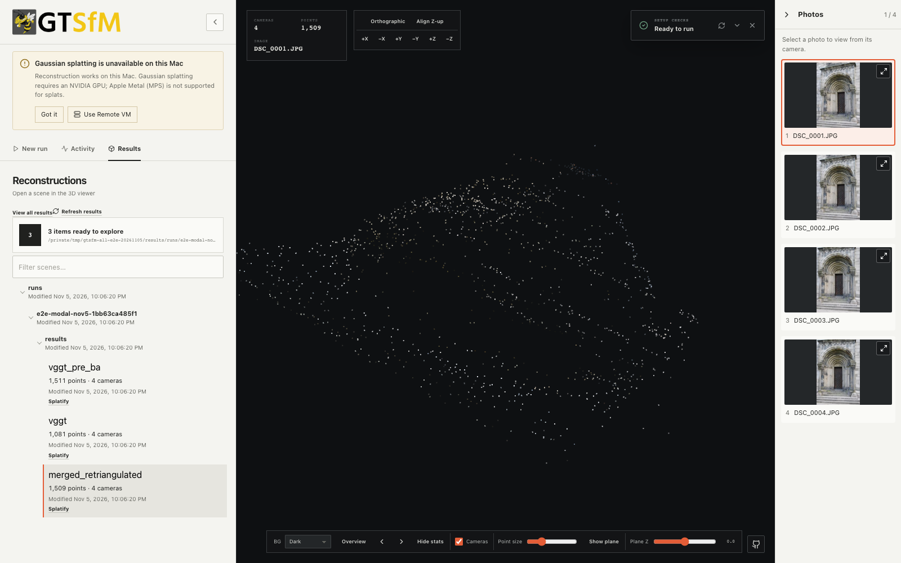

# Fresh Studio SSH and Modal acceptance, 2026-11-05

This sanitized evidence snapshot supports the review stack #1179 → #1180 → #1181 →
#1182 → #1164. It contains a real browser capture, not a fixture or mock deployment.
Raw logs, private host configuration and credentials are retained outside the PR.

## Modal Starter with a payment method

The production Studio UI uploaded the four-image Lund Door fixture and used:
VGGT SIFT frontend + MegaLoc, SIFT brute-force correspondences, resolution 518,
no splats, a Modal L4, 4 CPU cores and 32 GiB RAM.

- A real token deployed the GPU worker and lightweight CPU control service.
- Unauthenticated access to the jobs API returned HTTP 401.
- Run `1bb63ca485f1` completed, returned all nine camera/image/point export files,
  and rendered **4 cameras / 1,509 tracks** and four source photos locally.
- Download results produced a complete archive with four source images.
- Completed history and returned files survived a local Studio process restart.
- GPU runners and running inputs reached zero after completion and stayed at zero
  while status/result metadata endpoints were read.
- Studio's Stop button cancelled run `1e47c4fd6a4b` after the GPU pipeline reached
  VGGT inference preparation. Both local and remote state became cancelled;
  the native FunctionCall reported cancellation and GPU runners/inputs returned to zero.
- After inactivity, **both GPU and CPU control functions had zero runners and inputs**.
  The deployment remains available; there are no warm test containers.

## Bug found and fixed by the live test

The first cloud run completed its computation but advertised completion before
its final Volume commit. The control service cached that earlier snapshot, so
the client downloaded only metadata and could not open the reconstruction.

Commit `ba1fa8bb692f2896a4bacc15c8b1e8cc04c9fae1` in #1182 now commits before
publishing completion and withholds completed status while the control service's
Volume reload fails. Three regression checks failed against the old behavior;
all nine Modal module tests and 192 focused Python tests passed after the fix.
The complete production UI workflow was then repeated successfully on Modal.

## SSH cross-check

Real Mac → OpenSSH → native Ray → RTX 3080 runs `f71c950ee108` and `916a75f44b4b`
returned 4 cameras / 1,509 tracks; all 10 export hashes matched the retained
October 30 reference. The second followed native Ray teardown and a fresh
Studio process. Cancellation while GPU memory was 5,310 MiB returned Ray CPU/GPU
reservations to zero and memory to the predeclared desktop-idle tolerance.

## Numerical and scope limits

Modal's exports are **not byte-identical** to the RTX 3080 reference or between
the two observed cloud runs. The successful cloud run retained all 1,509 point IDs;
versus the RTX reference, the maximum camera-parameter difference was about
7.54e-5 pixels and maximum point-coordinate distance about 1.32e-7 in scene units.
These are observations, not a predeclared accuracy threshold or an accuracy guarantee.
Only the repeated RTX path established exact-output parity.

This fixture does not establish speedup, large-scene quality, Gaussian-splatting
quality or physical multi-host scale. The full 17-case benchmark matrix is
tracked independently in each PR's GitHub checks; see those checks for current
CI status rather than treating this dated acceptance snapshot as a CI result.
