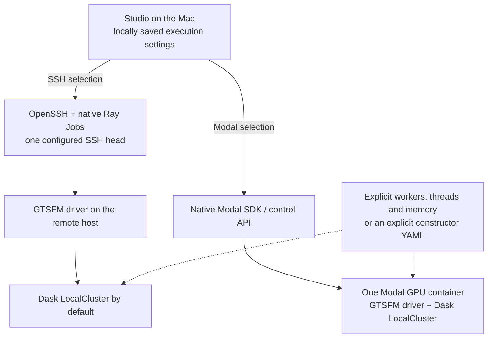
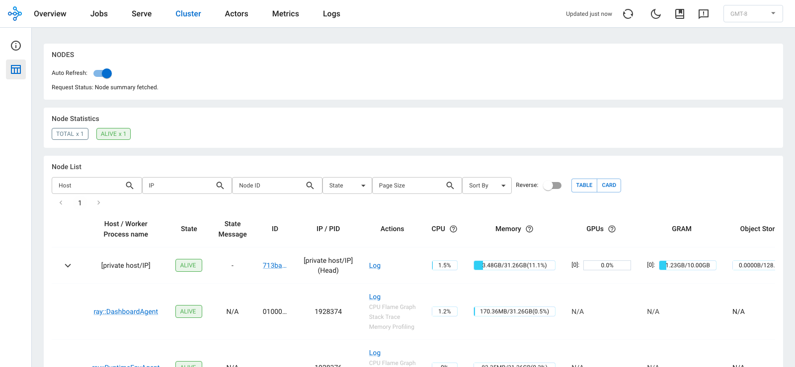

# Studio architecture clarification after the November 6 discussion

This is an infrastructure proposal for **post-CVPR review**, not a request to
change the paper's runtime before submission. No implementation PR has been
merged by this work. The code heads and existing implementation diffs remain
unchanged by this clarification.

## Corrections to the meeting description

| Statement | What the implementation and tests support |
| --- | --- |
| Ray combines machines into one machine that Dask automatically sees. | **Not implemented.** The adapter launches a whole GTSFM process on one SSH host. It does not derive a Dask topology from Ray nodes or resources. |
| Ray configures five machines/five GPUs and hands that cluster to Dask. | **Not implemented or tested.** The generated Ray configuration has one head, an empty worker-host list and zero additional workers. Explicit Dask host settings exist separately. |
| Ray provides a shared filesystem for this workflow. | **Not implemented.** This adapter copies directories with native `rsync-up`/`rsync-down`; that is not a shared distributed filesystem. |
| Modal requires Ray or is accelerated by Ray in this stack. | **False for this implementation.** Modal uses its own SDK, GPU Function, Volume and Dict. The Modal image excludes the optional SSH/development dependency groups. |
| The Studio Modal implementation already supports multiple GPUs/nodes. | **Unsupported claim.** The deployment API accepts individual GPU types, not GPU counts. The worker uses `cuda:0` and allows one GPU container at a time. Only one L4 was tested. This is not a Modal multi-node cluster implementation. |
| Ray enters at the first PR. | **False.** PRs 1–2 add no Ray package or running service. PR 2 already stores an anticipated `ssh_ray_binary` setting. PR 3 adds Ray to the optional SSH extra and development dependencies; PR 4 connects SSH jobs to it. |
| The Modal test reconstructed the full 12-camera Door scene. | **False.** The live cloud acceptance used a four-image Lund Door subset: 4 cameras and 1,509 tracks. Full Door-12 cases passed separately in CPU CI. |
| A per-Door reconstruction price was established. | **Not measured.** Account-wide spending is not a per-run cost. No billed per-reconstruction amount should be quoted from the current evidence. |
| The Studio stack validates the new camera-only hierarchical merger. | **False.** The merger and weighted partitioner are separate research proposals. The current live Studio fixture does not validate that hypothesis. |

Ray was selected as an off-the-shelf whole-job control service: submission,
status, streamed logs, cancellation and native CLI file transfer. Dask remains
`dask.distributed`. There is no `ray_dask_get` or `enable_dask_on_ray` integration.
Studio still supplies its own adapter and UI wiring around these stock services.
The separate [Dask-on-Ray scheduler](https://docs.ray.io/en/latest/ray-more-libs/dask-on-ray.html)
is not what these PRs implement. The need for an additional Ray runtime should
be compared explicitly with the existing Dask/SSH work before adoption.

Modal itself supports requesting multiple GPUs without requiring Ray; that
provider capability is different from implementing and validating its use in
Studio. Its per-container GPU-count syntax requests co-located devices; it does
not make the current Studio runner coordinate those devices. See
[Modal GPU configuration](https://modal.com/docs/guide/gpu).

Implementation anchors at the tested source heads:

- [Ray configuration: one head, no worker hosts](https://github.com/borglab/gtsfm/blob/fe85c1f9ca5fbe8b2265d3ccc85c642bd7318d60/visualization/ray_backend.py#L98).
- [Explicit runner workers/threads/memory arguments](https://github.com/borglab/gtsfm/blob/fe85c1f9ca5fbe8b2265d3ccc85c642bd7318d60/visualization/runtime.py#L925)
  and [Ray job reservation](https://github.com/borglab/gtsfm/blob/fe85c1f9ca5fbe8b2265d3ccc85c642bd7318d60/visualization/runtime.py#L1780).
- [Native Dask client construction](https://github.com/borglab/gtsfm/blob/fe85c1f9ca5fbe8b2265d3ccc85c642bd7318d60/gtsfm/runner.py#L556).
- [Modal GPU function and `cuda:0` runner](https://github.com/borglab/gtsfm/blob/fe85c1f9ca5fbe8b2265d3ccc85c642bd7318d60/visualization/modal_app.py#L157).
- [Anticipated Ray-binary setting in PR 2](https://github.com/borglab/gtsfm/blob/703c9a2648e50e2bd48f590aa5e27cc204405657/visualization/execution.py#L32)
  and [Ray dependency introduced by PR 3](https://github.com/borglab/gtsfm/blob/1317d1f93d475dc2b50bb71146ed1d1bf55ac0d5/pyproject.toml#L125).

## What Dask actually receives

There is **no automatic Ray-cluster-to-Dask-topology arrow**. In the recorded
successful runs, `cluster_config` was empty and the runner constructed a native
Dask LocalCluster from these submitted settings:

| Live path | Dask workers | Threads per worker | Worker memory limit | GPU allocation |
| --- | ---: | ---: | --- | --- |
| Modal L4 | 1 | 4 | `32GB` | One L4, requested through Modal; 4 CPU / 32768 MiB RAM |
| SSH / RTX 3080 | 1 | 2 | `18GiB` | One GPU reserved for the whole Ray entrypoint; two logical Ray CPUs |

The settings and run IDs are in [sanitized-run-settings.json](sanitized-run-settings.json).
They are submitted configuration, not a multi-machine scheduling measurement.
The default LocalCluster constructor does not synthesize GPU resource labels
from Ray. Selecting an explicit constructor YAML makes its constructor values
authoritative; it does not discover Ray resources.

For the single-host SSH path, the Ray CPU request is workers × threads. With
explicit external Dask worker hosts, Ray reserves one CPU for the driver and
Dask's explicitly configured remote workers own their computation. Ray resource
requests are logical scheduling reservations, not OS utilization limits; see the
[Ray Jobs SDK](https://docs.ray.io/en/latest/cluster/running-applications/job-submission/sdk.html).
Physical multi-host execution and topology propagation have not been validated.

## Dependency and review order

| Order | PR | Added responsibility | Ray decision |
| --- | --- | --- | --- |
| 1 | [#1179](https://github.com/borglab/gtsfm/pull/1179) | Native Dask constructors | Ray-free |
| 2 | [#1180](https://github.com/borglab/gtsfm/pull/1180) | Local named settings | No Ray runtime/dependency; already includes a Ray-binary setting |
| 3 | [#1181](https://github.com/borglab/gtsfm/pull/1181) | SSH job control using Ray | **First explicit Ray dependency** |
| 4 | [#1182](https://github.com/borglab/gtsfm/pull/1182) | Studio remote jobs and result retrieval | SSH uses Ray; Modal uses Modal directly |
| 5 | [#1164](https://github.com/borglab/gtsfm/pull/1164) | Saved-configuration and execution UI | Depends on the combined backend |

Runtime independence is not merge independence: the current bases form one
chain, so merging PRs 4–5 as currently stacked includes PR 3. Accepting Modal/UI
before deciding on Ray would require a separate restack/split. This clarification
does not rewrite that history or pretend the branches are independently mergeable.
Frank's comments did not reject Ray; they asked where that commitment occurs.

## Existing visual and execution evidence

- Native Ray dashboard from the tested SSH host: **one live node**, with host/IP
  and address-bearing resource fields masked. This is a current idle dashboard;
  no reconstruction was launched to produce it. It does not display an aggregate
  Ray/Dask cluster or establish multi-node execution. Child rows are Ray helper
  processes on that same node, not additional machines or Dask workers. The native
  state API reported 16 logical Ray CPUs and one GPU; that inventory was not
  automatically converted into a Dask topology.

  

- [Real Modal result and lifecycle evidence](../2026-11-05/README.md): four-image
  upload, reconstruction, returned exports/photos, rendering, Stop and completed
  result persistence across a Studio restart.
- [Studio UI gallery](https://github.com/borglab/gtsfm/pull/1164): saved settings,
  explicit unsupported legacy fields, connection states and real SSH output.
- This evidence establishes single-host lifecycle behavior. It does not establish
  physical multi-node scaling, multi-GPU performance or a common Ray/Dask resource pool.

## Validation and remaining work

The full 17-case matrix was attempted on each of five PRs. **84/85 cases passed**;
all five unit/lint and browser check groups passed. Four PRs are fully green.
The #1179 LightGlue/Skydio-32 retry reproduced a GTSAM/Dask deserialization error
and [hit the six-hour execution limit](https://github.com/borglab/gtsfm/actions/runs/42166881576/job/127789175565).
No benchmark skip marker, extra retry or passing-result substitution hides it.
There is no complete green benchmark or academic no-regression claim.

Before broader infrastructure claims, still needed:

1. Resolve the remaining numerical/serialization benchmark failure.
2. If automatic topology handling is required, choose and specify that design;
   the current whole-job launcher does not implement it.
3. Test distinct physical hosts and GPU identities, effective Dask worker/thread/
   memory placement, cancellation and resource cleanup before claiming multi-node support.
   Also run the acceptance scenario on the actual Cyber/cluster environment;
   a saved configuration named "Cluster" is not evidence of batch allocation or
   scheduler integration. Those site-specific steps have not been validated here.
4. Attribute a provider-billed cost to a named reconstruction before quoting its price.
5. Review the prior Dask/SSH prototype and record why an additional runtime is warranted.

## The paper experiment is a separate workstream

Frank's [camera-only hierarchical merger, #1184](https://github.com/borglab/gtsfm/pull/1184),
is a standalone solver with a 12-camera Lund fixture. Its PR states that it is
separate from production merging. Kusum's [weighted partitioning work, #1178](https://github.com/borglab/gtsfm/pull/1178)
is also separate. This Studio stack should support launching and observing such
experiments, not claim to implement or prove their algorithm.

The primary experiment described in the meeting needs weighted partitioning,
every camera represented in at least one leaf, VGGT plus BA at leaves, elimination
of leaf structure to camera information, and the camera/Sim3 root solve. Intrinsics
are held at their leaf estimates; the production leaf/solver camera-model interface
also needs validation (the solver proposal currently specifies fixed Cal3Bundler).
It needs zero BA above the leaves and no global
cross-leaf track/retriangulation stage in that baseline. A leaf-local point refresh
after correcting cameras should be distinguished from the global retriangulation
alternative discussed on the call.

That experiment should progress from full Door to the next small scene, Gerrard
Hall, Palace and eventually Dubrovnik, retaining each failure case and measured
quality/runtime/resource results. The current Studio GPU fixture, default merging
path and passing CPU benchmarks do not constitute that experiment.
