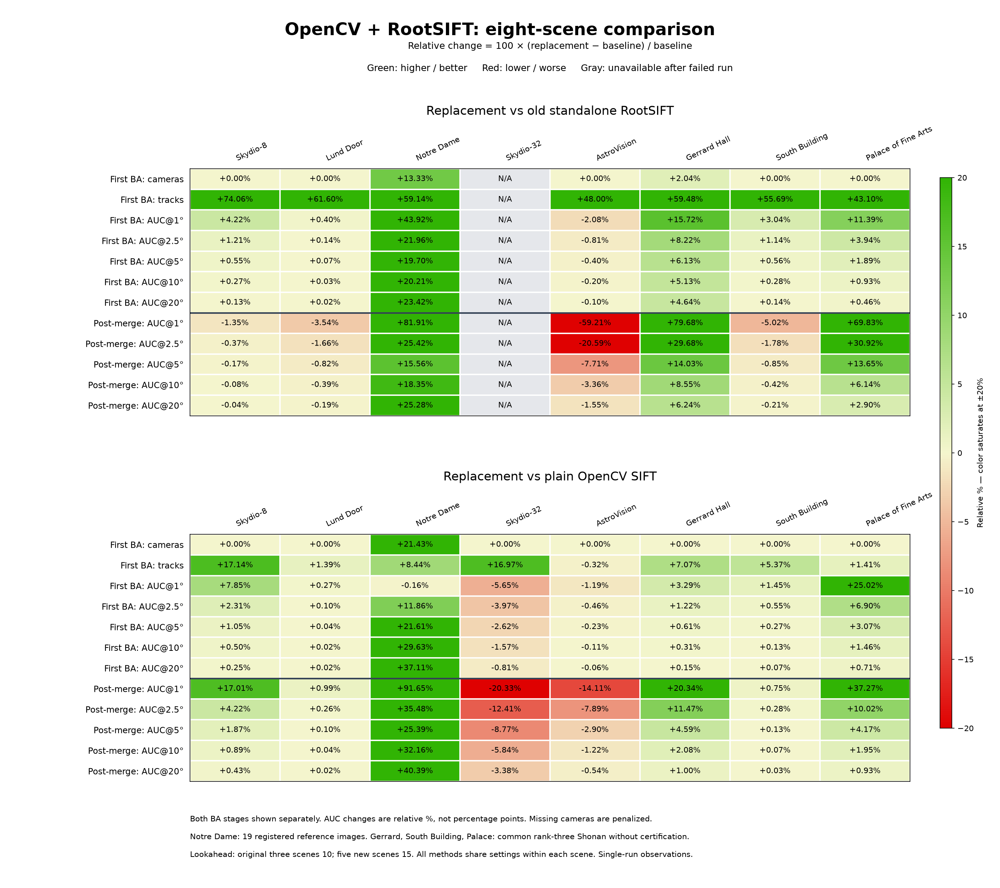

# Replace standalone RootSIFT with joint OpenCV extraction

`RootSIFTDetectorDescriptor` applies L1 normalization and an elementwise square
root to the descriptors returned by `SIFTDetectorDescriptor.detect_and_describe()`.
OpenCV computes these descriptors using its original orientation, octave, and
scale information. The old `RootSIFTDescriptor.describe(image, keypoints)` path
recomputed SIFT descriptors after conversion through GTSFM `Keypoints`, which
stores coordinates, scales, and responses but drops orientation and octave.
The normalization formula itself was already correct; the replacement avoids
that lossy round trip and a second descriptor computation.

The output stays float32, including with NumPy 2, for OpenCV matcher compatibility.
The new class also has its own detector-descriptor cache namespace. Plain SIFT
remains available and the default extractor is unchanged.

## API migration

Replace the removed standalone `gtsfm.frontend.descriptor.rootsift.RootSIFTDescriptor`
with the combined extractor:

```python
from gtsfm.frontend.detector_descriptor.rootsift import RootSIFTDetectorDescriptor

keypoints, descriptors = RootSIFTDetectorDescriptor(max_keypoints=5000).detect_and_describe(image)
```

For an existing SIFT runner configuration, override:

```text
cluster_optimizer.correspondence_generator.detector_descriptor.detector_descriptor_obj._target_=gtsfm.frontend.detector_descriptor.rootsift.RootSIFTDetectorDescriptor
```

This is an API change: the replacement detects its own keypoints and does not
provide `describe(image, arbitrary_keypoints)`. No production callers of the old
class were found in the repository; its unit and reproducibility tests are
replaced with tests for joint extraction. Upright SIFT is outside this change.

## Recorded comparison



[Download the interactive dashboard](opencv-rootsift-comparison.html.zip) and open
its HTML file in a browser (internet access is needed for Plotly). Hover over a
cell for the before/after values. The [plotted data](opencv-rootsift-comparison.json)
includes metric labels, source report hashes, and provenance. Percentages are
relative changes, not percentage-point differences; color saturates at ±20%.
Gray cells indicate an unavailable baseline after the old Skydio run failed.

The [standard GTSFM dashboards](opencv-rootsift-standard-dashboards.zip) are also
available. These run the existing `visualize_benchmark_comparison.py` generator
unchanged on the original saved HTML reports, with all nine standard metric
sections. The archive contains two dashboards: replacement versus plain OpenCV
(all eight scenes), and replacement versus standalone RootSIFT
(all available final reports; Skydio-32 failed and has no final report). In their
hover text, "Master" means the baseline extractor and "Branch" means OpenCV + RootSIFT.

The standard dashboards preserve the original reported scores, including the
uncorrected Skydio OpenCV pose-AUC denominator and constructed-camera-only scores.
Use the custom comparison and tables below for corrected full-reference pose AUC.
The stock dashboard omits the later post-merge BA section. Its runtime rows are
not controlled timing comparisons because runs reused caches and shared the host.
The archive README records these limitations and the source report paths.

This uses the red/green style of `gtsfm/evaluation/visualize_benchmark_comparison.py`,
but draws from the recorded JSON metrics to preserve the corrected reference-image
denominators. For ordinary CI artifact comparisons, the existing command is:

```bash
python gtsfm/evaluation/visualize_benchmark_comparison.py \
  --master_path /path/to/before-artifacts \
  --branch_path /path/to/after-artifacts \
  --output_path visual_comparison_dashboard.html
```

These are existing runs, not benchmarks rerun for this change. The benchmark
harness and original reports are preserved on `codex/sift-rootsift-comparison`
at commit `f558a601`; production code in those runs was based on master
`8f21351c`. The three variants used identical OpenCV detections and feature
limits. The legacy adapter cast its output to float32 so that NumPy 2 promotion
did not prevent matching. The combined adapter normalized the original OpenCV
descriptors; an exact-equality regression test checks the replacement against that formula.

All rows use the first bundle-adjustment output. AUC values are percentages.

| Dataset | Extractor | Cameras | Tracks | Pose AUC@1° | Pose AUC@5° |
|---|---|---:|---:|---:|---:|
| Lund Door | OpenCV SIFT | 12/12 | 6,981 | 84.68 | 96.94 |
| Lund Door | Standalone RootSIFT (old) | 12/12 | 4,380 | 84.57 | 96.91 |
| Lund Door | OpenCV + RootSIFT (replacement) | 12/12 | 7,078 | 84.91 | 96.98 |
| Skydio-32 | OpenCV SIFT | 29/32 | 1,167 | 47.52 | 71.92 |
| Skydio-32 | Standalone RootSIFT (old) | Failed | — | — | — |
| Skydio-32 | OpenCV + RootSIFT (replacement) | 29/32 | 1,365 | 44.84 | 70.03 |
| Gerrard Hall | OpenCV SIFT | 100/100 | 14,022 | 86.81 | 97.31 |
| Gerrard Hall | Standalone RootSIFT (old) | 98/100 | 9,414 | 77.48 | 92.25 |
| Gerrard Hall | OpenCV + RootSIFT (replacement) | 100/100 | 15,013 | 89.66 | 97.91 |

The replacement retains substantially more tracks than standalone RootSIFT on
Door and Gerrard Hall, and improves camera coverage and pose accuracy on
Gerrard Hall. Compared with plain OpenCV, normalization increases track counts
on all three scenes but lowers pose AUC on Skydio. These results support replacing
the lossy standalone path, not claiming that RootSIFT always outperforms SIFT.

### Conditions and limitations

- Runs used GTSAM 4.3.0, NumPy 2.2.6, and OpenCV 5.0.0.93; the same `unified`
  backend, shared intrinsics, 5,000-feature limit, five NetVLAD neighbors plus
  sequential lookahead ten, mutual brute-force matching with ratio 0.8, OpenCV
  RANSAC, and two-view BA. Door used a 1296-pixel short-side limit and 65 retrieved
  pairs; Skydio used 760 pixels and 303 pairs; Gerrard Hall used 760 pixels and
  974 pairs.
- Door uses the Olsson reference. Skydio and Gerrard Hall use COLMAP-derived
  reference poses, not independently measured ground truth. No COLMAP feature
  extractor is used by the replacement.
- Skydio and Gerrard Hall scores use all reference-image pairs (496 and 4,950),
  counting missing cameras as failures. Pose error is the maximum of relative
  rotation and translation-direction error. Skydio's saved OpenCV pipeline score
  omitted a reference camera; the table uses the corrected denominator.
- Gerrard Hall used the same experiment-only rank-three Shonan solve with
  certification disabled for all three methods. Default OpenCV and normalized
  runs were stopped because of time and memory growth. Production solver settings
  are unchanged by this PR.
- Standalone RootSIFT on Skydio collapsed from 896 tracks to one during BA and
  then failed during result deserialization. This repeated with cached frontend
  outputs; it is not a clean measure of descriptor quality or proof of the
  failure's cause.
- These are single-scene trials, not an ETH3D reproduction or a VLFeat comparison.
  There is no controlled runtime comparison.

The later post-merge retriangulation/BA stage is separate from the first-BA
scores above. Its pose AUC@5° was:

| Dataset | OpenCV SIFT | Standalone RootSIFT | OpenCV + RootSIFT |
|---|---:|---:|---:|
| Lund Door | 86.04 | 86.84 | 86.13 |
| Skydio-32 | 71.93 | Failed | 65.62 |
| Gerrard Hall | 81.78 | 75.01 | 85.53 |

The post-merge degradation has not been diagnosed. First-BA scores should not
be described as the final pipeline accuracy.

## Five additional benchmark scenes

The comparison was extended to the five remaining locally available CI scenes.
The [experiment branch](https://github.com/borglab/gtsfm/tree/codex/rootsift-five-benchmarks)
preserves the benchmark harness and machine-readable results.
All three feature extractors were run on each scene using the same production
base (`8f21351c`) and the experiment-only harness extensions at `364d8032` and resumption support at `40f6d212`.
The normalization adapter is the one tested against the replacement implementation.
No COLMAP or VLFeat feature extractor was run.

Each scene uses the CI resolution limit and calibration-sharing setting, five
NetVLAD neighbors, sequential lookahead 15, a 5,000-feature limit, mutual
brute-force matching at ratio 0.8, OpenCV RANSAC, two-view BA, one worker and
one thread. Notre Dame uses separate intrinsics; the other four share intrinsics.
The original Door/Skydio-32/Gerrard runs used lookahead 10, so settings are
matched between extractors within each scene rather than across all eight scenes.

| Scene | Reference images | Short-side limit | Retrieved pairs | Rotation solver |
|---|---:|---:|---:|---|
| Skydio-8 | 8 | 760 | 28 | default Shonan |
| Notre Dame | 19 | 760 | 165 | default Shonan |
| AstroVision | 65 | 1024 | 870 | default Shonan |
| South Building | 128 | 760 | 2006 | rank-three Shonan without certification |
| Palace of Fine Arts | 281 | 320 | 4178 | rank-three Shonan without certification |

Notre Dame contains 20 image files, but its supplied reference model registers
19; the loader uses those 19. South Building and Palace use the same rank-three
Shonan objective without certification for every extractor, as in the earlier
Gerrard Hall experiment. The three smaller scenes use the default Shonan solver.
Skydio, Notre Dame, South Building, and Gerrard references are COLMAP-derived
poses, not independent ground truth. Palace uses Olsson `data.mat`; AstroVision
uses its supplied reference model.

Scores below use all reference-image pairs, count missing cameras as failures,
and report pose AUC as percentages. The first and post-merge BA stages are
reported separately. Runtime was not controlled.

### First bundle adjustment

| Dataset | Extractor | Cameras | Tracks | AUC@1° | AUC@5° |
|---|---|---:|---:|---:|---:|
| Skydio-8 | OpenCV SIFT | 8/8 | 315 | 58.29 | 91.61 |
| Skydio-8 | Standalone RootSIFT (old) | 8/8 | 212 | 60.32 | 92.06 |
| Skydio-8 | OpenCV + RootSIFT | 8/8 | 369 | 62.87 | 92.57 |
| Notre Dame | OpenCV SIFT | 14/19 | 1,268 | 22.95 | 42.89 |
| Notre Dame | Standalone RootSIFT (old) | 15/19 | 864 | 15.92 | 43.57 |
| Notre Dame | OpenCV + RootSIFT | 17/19 | 1,375 | 22.91 | 52.16 |
| AstroVision | OpenCV SIFT | 65/65 | 22,139 | 95.89 | 99.18 |
| AstroVision | Standalone RootSIFT (old) | 65/65 | 14,911 | 96.76 | 99.35 |
| AstroVision | OpenCV + RootSIFT | 65/65 | 22,068 | 94.75 | 98.95 |
| South Building | OpenCV SIFT | 128/128 | 21,310 | 91.63 | 98.33 |
| South Building | Standalone RootSIFT (old) | 128/128 | 14,423 | 90.22 | 98.04 |
| South Building | OpenCV + RootSIFT | 128/128 | 22,455 | 92.96 | 98.59 |
| Palace of Fine Arts | OpenCV SIFT | 281/281 | 12,651 | 51.49 | 89.22 |
| Palace of Fine Arts | Standalone RootSIFT (old) | 281/281 | 8,965 | 57.79 | 90.25 |
| Palace of Fine Arts | OpenCV + RootSIFT | 281/281 | 12,829 | 64.37 | 91.96 |

### Post-merge retriangulation/BA

| Dataset | Extractor | Cameras | Tracks | AUC@1° | AUC@5° |
|---|---|---:|---:|---:|---:|
| Skydio-8 | OpenCV SIFT | 8/8 | 320 | 49.53 | 89.91 |
| Skydio-8 | Standalone RootSIFT (old) | 8/8 | 223 | 58.75 | 91.75 |
| Skydio-8 | OpenCV + RootSIFT | 8/8 | 380 | 57.96 | 91.59 |
| Notre Dame | OpenCV SIFT | 14/19 | 1,316 | 13.21 | 38.14 |
| Notre Dame | Standalone RootSIFT (old) | 15/19 | 881 | 13.92 | 41.38 |
| Notre Dame | OpenCV + RootSIFT | 17/19 | 1,415 | 25.31 | 47.82 |
| AstroVision | OpenCV SIFT | 65/65 | 22,184 | 6.74 | 71.98 |
| AstroVision | Standalone RootSIFT (old) | 65/65 | 14,964 | 14.19 | 75.73 |
| AstroVision | OpenCV + RootSIFT | 65/65 | 22,138 | 5.79 | 69.89 |
| South Building | OpenCV SIFT | 128/128 | 21,582 | 78.10 | 95.55 |
| South Building | Standalone RootSIFT (old) | 128/128 | 14,651 | 82.84 | 96.49 |
| South Building | OpenCV + RootSIFT | 128/128 | 22,704 | 78.69 | 95.67 |
| Palace of Fine Arts | OpenCV SIFT | 281/281 | 13,176 | 33.35 | 81.57 |
| Palace of Fine Arts | Standalone RootSIFT (old) | 281/281 | 9,558 | 26.96 | 74.77 |
| Palace of Fine Arts | OpenCV + RootSIFT | 281/281 | 13,402 | 45.78 | 84.98 |

The [machine-readable five-scene results](sift-five-more-comparison.json)
contain the exact commands, package versions, process status, all AUC thresholds,
missing camera names, and original pipeline-reported AUC values alongside the
fixed-reference evaluation. Raw logs, configurations, reconstructions, and
per-pair errors remain under `/tmp/gtsfm-sift-five-results`.

Both the custom chart and standard dashboards above now include these scenes.
The custom chart uses fixed-reference scores. The unchanged standard generator
uses the original HTML reports and retains their original metric definitions.
Failed runs without a final report are omitted from the stock comparison;
the custom comparison marks them unavailable.

Across the five new scenes, the replacement retains 43–74% more first-BA tracks
than standalone RootSIFT and improves AUC@5° on four of five scenes. Notre Dame
also improves from 15/19 to 17/19 registered reference cameras (plain OpenCV
registers 14/19). AstroVision is the exception: standalone RootSIFT scores 99.35%
versus 98.95% for the replacement, despite its lower track count. Compared with
plain OpenCV, the replacement also improves AUC@5° on four of five new scenes;
AstroVision falls from 99.18% to 98.95%. The observations support removing the
lossy standalone path while retaining plain SIFT as an available default.

The post-merge stage changes that ranking: against standalone RootSIFT, the
replacement improves AUC@5° on Notre Dame and Palace, but scores lower on
Skydio-8 (91.59% vs 91.75%), South Building (95.67% vs 96.49%), and AstroVision
(69.89% vs 75.73%). Against plain OpenCV it improves post-merge AUC@5° on four
of five new scenes, again excluding AstroVision. Consequently, the first-BA
gains and larger track counts do not establish a universal improvement in final
pipeline accuracy. The post-merge behavior remains uninvestigated.

Validation: all 15 new reconstruction trials completed successfully. Resolved
configurations match across the three methods on each of the five scenes except
for extractor class and output location. Fixed-reference evaluation asserts the
full N(N-1)/2 pair count. The replacement's 43 focused tests and exact CI flake8
check passed after strengthening descriptor equivalence to exact equality; eight
experiment-harness, evaluation, and rotation-solver tests also passed.
