# Studio UI review gallery

This gallery covers the frontend changes split from #1164. Review the source in
`visualization/frontend/src/main.tsx`; `visualization/static/studio.js` is its
committed production bundle. See the PR descriptions for dependency/merge order.

Images 01–12 are actual browser renders of deterministic API fixtures, not cloud
execution evidence. Hosts, credentials and endpoints in those images are fake.
Image 13 reopens the existing real RTX 3080 reconstruction through local Studio;
it does not represent a new GPU run. Modal GPU execution remains billing-blocked.

The baseline is `adc793547b63374a89cd6215f7edeb901d4569e9`; the implementation is
`c8b5c1b69e62278974bad1ac9e6874ea29b439b9`. The split preserves the implementation
byte for byte. Capture details and image hashes are in [manifest.json](manifest.json).

## Saved configurations

Before, Compute had only a target/device choice. After, it can load, save, reload
and delete named machine settings. Loading populates the visible controls;
subsequent edits apply to the next run, and Save explicitly updates the stored copy.
Secrets and dataset/pipeline settings are not saved in these configurations.

| Before | After |
| --- | --- |
| 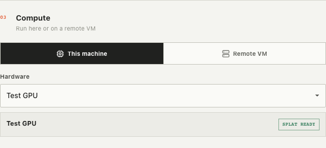 | 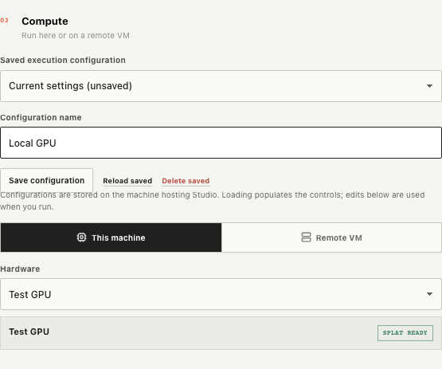 |

Review `EXECUTION_FIELDS`, `loadExecution`, `saveExecution`, `deleteExecution` and
the Compute section. Persistence/API validation is covered by `test_execution.py`;
cross-instance/process transactions by `test_execution_store.py`.

## Editable local and external worker settings

Worker/thread/memory settings remain editable for a selected accelerator. Saved
settings are preserved across hardware discovery. External SSH worker hosts expose
worker-device selection independently of the CPU-only control machine; those fields
feed the native Dask SSHCluster constructor. A constructor YAML path remains an
expert override and cannot be hidden inside a saved configuration.

| Local worker controls | External worker controls |
| --- | --- |
| 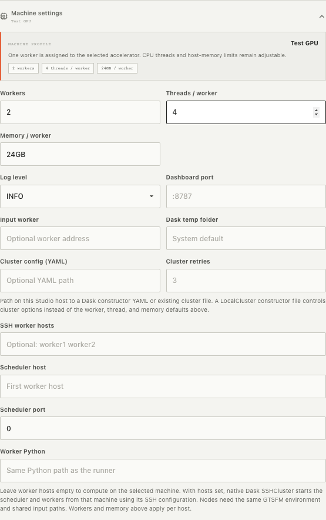 | 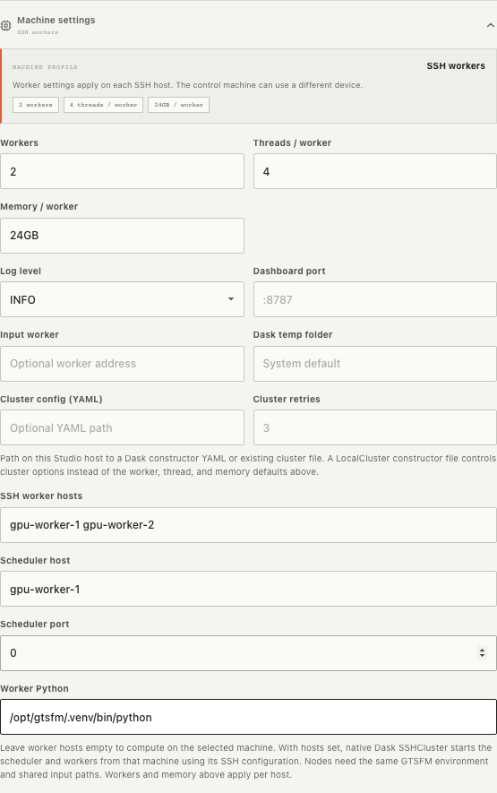 |

Review `advancedMachineProfile`, the default-update effects, `hasExternalWorkers`
and Machine settings. Backend coverage includes native constructor generation and
CPU control nodes selecting worker GPUs. Multi-host scale has not been live-tested.

## Direct Linux SSH with native Ray

The new SSH choice exposes host, user, port, remote checkout/Python/Ray and device.
It uses the local OpenSSH configuration/agent. Identity files must stay local;
private keys are not supplied to Ray. Check SSH connection starts/reuses the
preinstalled native runtime. A direct Linux SSH endpoint is required.

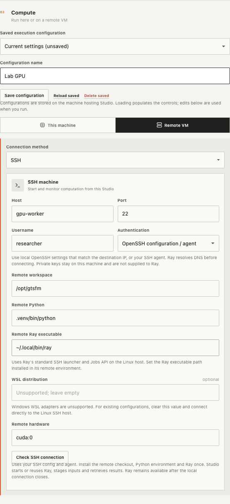

Legacy WSL adapters and key authentication remain visible as unsupported saved
values so users can correct them explicitly. They disable connection/run rather
than silently switching authentication or running on another host.

| Unsupported saved configuration | Explanation |
| --- | --- |
| 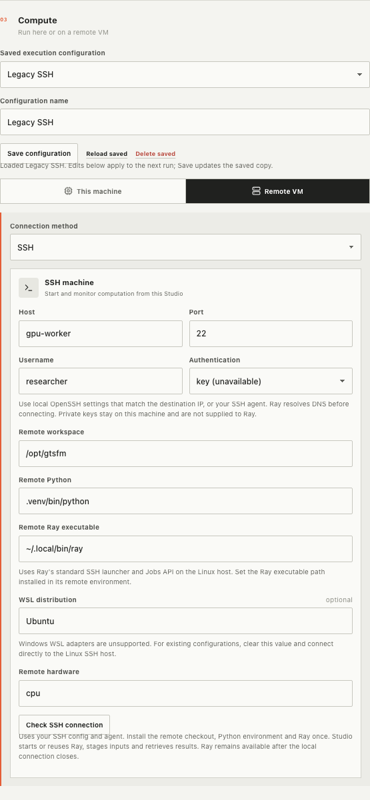 | 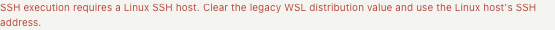 |

Review `sshConnectionError`, connection/run disabled predicates, `connectRemote`,
and the SSH panel. The browser test exercises replacing legacy WSL/key settings.

## Modal onboarding and device consistency

The setup flow remains visible with its GPU selection and deployment progress.
A fresh verified workspace selects `cuda:0`. Loading an explicit CPU choice keeps
that choice visible as unavailable and blocks the run until the user selects its
GPU. Green deployment states below are fixture responses, not a real Modal GPU run.

<details>
<summary>Onboarding and unavailable → corrected GPU screenshots</summary>

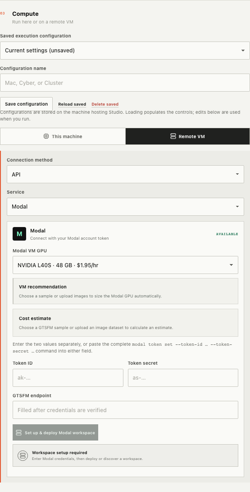

| Loaded CPU configuration | Corrected GPU configuration |
| --- | --- |
| 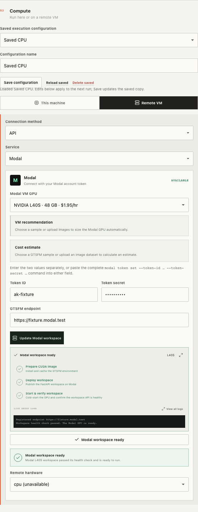 | 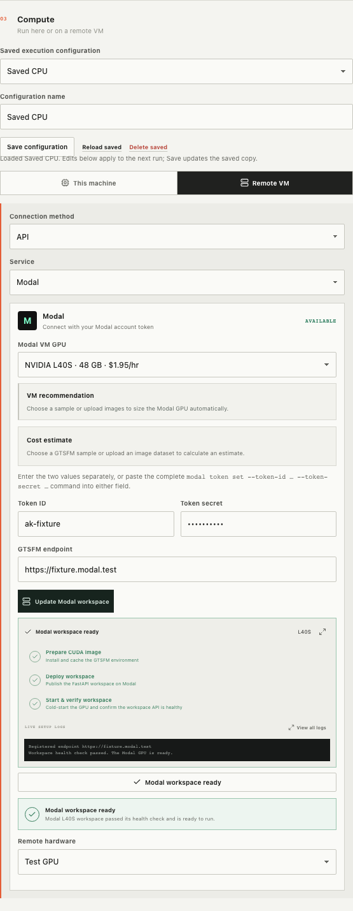 |

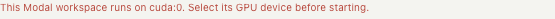

</details>

Review the hardware default effects, unavailable select options and `deviceError`.
Browser coverage checks fresh onboarding and loaded CPU configurations; backend
coverage rejects a mismatched device independently of the browser.

## Completed-run actions and real result rendering

Completed jobs offer View results and Download results, including reconstructions
without splats. The result download API and source-photo mapping belong to the
backend review. The browser action screenshot below uses a completed-job fixture.

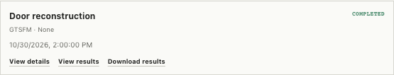

This fresh browser capture reopens the real completed SSH/Ray run `113126d2ed30`
from October 30: 4 cameras, 1,509 tracks and source photos rendered locally.
All 10 exported files matched the retained baseline in that acceptance test.

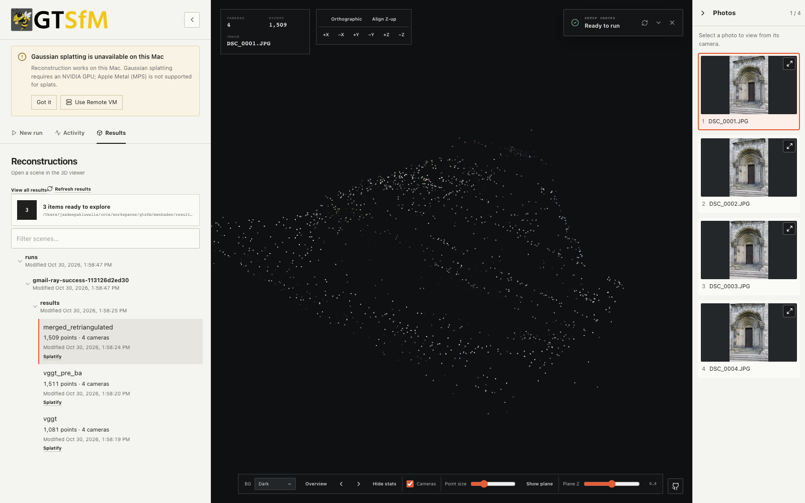

## Validation

The production build, 19 viewer tests, 12 browser tests and 187 relevant Python tests
passed during this review split. The gallery fixture capture reported zero uncaught
browser errors. No new remote/GPU workload was launched for these screenshots.

```sh
npm run build --prefix visualization/frontend
npm run test:viewer --prefix visualization/frontend
npm run test:browser --prefix visualization/frontend
.venv/bin/python -m pytest tests/test_runner_native_cluster.py tests/visualization -q --no-cov
```
